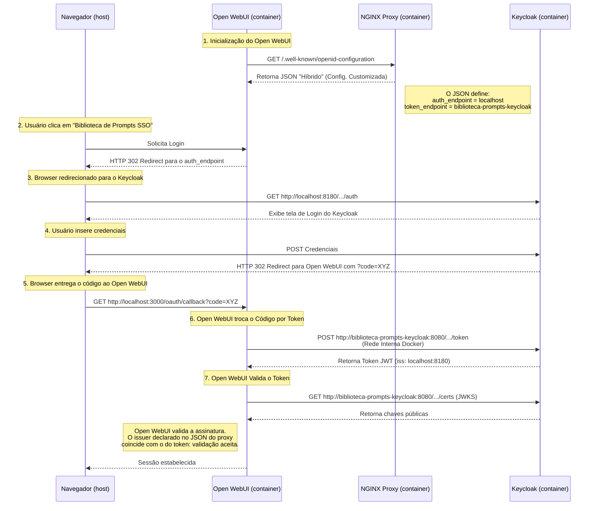

# Arquitetura do Login com OIDC Proxy (Open WebUI + Keycloak)

O problema clássico do Docker no Windows (WSL) com OAuth2/OIDC (OpenID Connect) é que o **Navegador do Usuário** e os **Contêineres** enxergam a rede de formas diferentes:
- O navegador usa `localhost` para acessar o Keycloak.
- Os contêineres usam os nomes dos serviços (ex: `biblioteca-prompts-keycloak`) para se comunicarem na rede interna do Docker.

O **NGINX OIDC Proxy** foi criado para entregar um documento de configuração (Discovery Document) "híbrido", enviando o endereço certo para a entidade certa.

---

## 1. O Problema da `Issuer` (Emissor do Token)

Quando um token JWT é gerado pelo Keycloak, ele recebe uma assinatura digital e um campo chamado `iss` (Issuer), declarando quem emitiu o token. 
Se o Keycloak está configurado como `KC_HOSTNAME=http://localhost:8180`, todo token gerado terá `iss: "http://localhost:8180/realms/biblioteca-prompts"`.

Para que a segurança funcione, o Open WebUI e a API Java (Backend) **precisam validar** se o token foi realmente emitido por quem eles confiam. Eles fazem isso consultando as configurações do provedor OIDC.

### Por que o Open WebUI travava?
O Open WebUI lê o documento de configuração para descobrir os endpoints (URLs) do Keycloak. Se ele lesse o original do Keycloak, as URLs apontariam para `localhost:8180`. Como o Open WebUI roda *dentro* de um contêiner, para ele `localhost` é ele mesmo! Ele tentava conectar na própria porta 8180 e falhava (Time out / Erro 400).

---

## 2. Diagrama de Arquitetura (O Papel do NGINX Proxy)

Abaixo temos o fluxo completo desde o momento em que o Open WebUI inicia até o usuário fazer o login:

---

## 3. Dissecando o JSON do `nginx-oidc-proxy.conf`

O proxy responde ao documento de descoberta OIDC com endpoints distintos para
cada consumidor. A tabela abaixo detalha cada campo:

| Campo do JSON | Valor Injetado pelo NGINX | Quem Usa? | Por que esse valor? |
| :--- | :--- | :--- | :--- |
| `issuer` | `http://localhost:8180/realms/biblioteca-prompts` | Open WebUI e API Java | Para o validador de token aceitar a marcação oficial que o Keycloak coloca nos tokens. |
| `authorization_endpoint` | `http://localhost:8180/.../auth` | Navegador (Windows) | A tela de login tem que abrir na máquina do usuário. O Open WebUI repassa essa URL para o navegador fazer o redirecionamento. |
| `token_endpoint` | `http://biblioteca-prompts-keycloak:8080/.../token` | Open WebUI (Servidor) | Feito de máquina para máquina (backend to backend). Precisa usar a rede interna do Docker para comunicação direta, ignorando o Windows. |
| `userinfo_endpoint` | `http://biblioteca-prompts-keycloak:8080/.../userinfo` | Open WebUI (Servidor) | Mesma coisa do token. Máquina para máquina na rede fechada do Docker. |
| `jwks_uri` | `http://biblioteca-prompts-keycloak:8080/.../certs` | Open WebUI (Servidor) | Para o Open WebUI baixar a chave criptográfica que valida o token, diretamente pela rede veloz do Docker. |

---

> **Resumo da Ópera:** O NGINX age como um "tradutor" que entende a esquizofrenia de redes entre o seu computador físico (Windows) e o ecossistema fechado do Docker, dizendo para o Open WebUI exatamente qual rota ele deve usar para cada tarefa específica do ciclo de vida do OAuth2.
